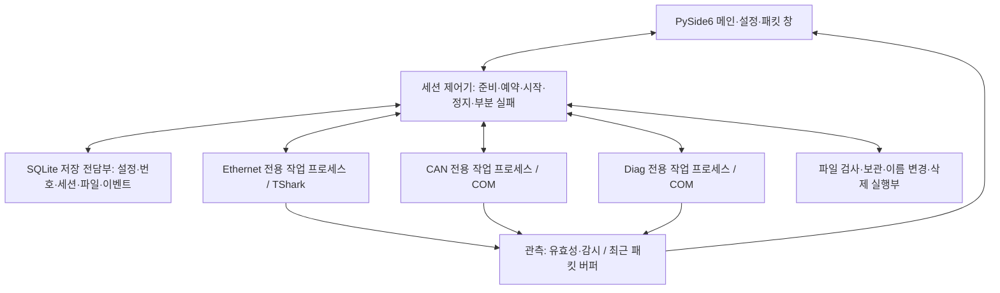

# 프로그램 구현 작업 계획

작성일: 2026-10-17 (Asia/Seoul)
현황 갱신: 2026-10-18, 소스 버전 0.8.0. 현재 작업별 진행은 **5절**, 다음 작업 순서는 **10절**을 기준으로 본다. 작업 ID와 최종 완료 기준은 기존 계획을 유지한다. [0.5.1 수정](canoe_fix_plan.md)에서 CANoe 독립 연결·출력 옵션 복구, [0.6.0](development_stage_6.md)에서 수동 복구, [0.7.0](development_stage_7.md)에서 Ethernet 감시, [0.8.0](development_stage_8.md)에서 기록 품질 계측·버퍼 설정·번호 기반 부하 검사를 추가했다. 실제 CAN/Diag 구간 기록은 라이선스 준비 후 검증한다.

현재 구현: Qt UI·설정/번호/이력, TShark Ethernet 취득·최근 패킷·명시적 규칙 감시, 완료 파일 관리·미완료 수동 복구, 상시 진단·버그리포트와 버전별 자동 빌드. CAN/Diag COM 제어는 시험용이며 대표 .cfg 측정·기록, CAN/Diag 수신 이벤트·하드웨어 채널 관측, 실제 차량·고부하·새 PC 검증이 남아 있다. 최신 검증 근거는 [7단계 결과](development_stage_7.md)를 따른다.
기준: [요구사항](requirements.md), [제어 정책](control_policy.md), [설계](architecture.md), [검증 계획](validation_plan.md).

## 1. 파악한 프로그램과 현재 상태

이 프로그램은 CANoe 두 대상을 CAN·Diag로, Ethernet 캡처 대상을 Zipy로 표시하는 Windows 로컬 제어 패널이다. 사용자가 CANoe의 측정을 시작해 둔 상태에서 선택한 대상의 구간 로그만 공통 `logging` 버튼으로 시작·정지한다. 한 세션의 BLF 0~2개와 PCAP/PCAPNG 0~1개를 같은 번호로 관리하며, 기록 상태·최근 패킷·통신 경고·파일 처리 결과를 보여준다. 아무 대상도 선택하지 않은 세션은 시작하지 않는다.

계획 수립 당시 요구사항은 DEV-01을 포함한 55개이며 검증 시나리오는 T-01~T-66이다. `src/vil_logging/`에 Python 패키지·앱 진입점·Qt 화면·대상별 모의 작업 프로세스·SQLite·환경/개발자 진단을 구현했다. 화면 시안은 `docs/design/wireframe.html`에 보관한다. 모의 실행은 별도 DB를 사용하고 실제 BLF/PCAP를 생성하지 않는다. 이후 TShark 취득과 파일 관리 구현은 단계별 개발 결과에 기록했으며, 최신 소스 범위는 [README](../README.md)를 따른다.

[개발 PC 점검](development_pc_audit.md)에는 Python 3.9.2와 CANoe 19.3.118 실행 파일 등이 기록돼 있다. 이 기록은 시험 PC의 라이선스·COM·장비 동작을 입증하지 않는다. Wireshark 도구와 Npcap도 점검 범위에서 발견하지 못한 상태이며, 비표준 설치 여부는 별도 확인 대상이다.

이후 Python 3.14.7 x64를 설치하고 `%LOCALAPPDATA%/VILLogging/development/venv314`에 가상환경과 실행/개발 의존성을 준비했다. 작업 폴더에 대한 신규 Python 쓰기 제한을 변경하지 않고 AppData 개발 환경을 사용한다. 읽기 전용 환경 진단은 파일·COM 등록·버전과 확인 범위를 구분하며 실제 CANoe/NIC는 열지 않았다. 개발 환경 준비 이력은 [1단계 결과](development_stage_1.md), 이후 실제 취득·파일 관리와 배포 결과는 단계별 기록과 [5단계 결과](development_stage_5.md)를 따른다.

남은 핵심 선행 작업은 **CANoe의 독립 제어와 측정 유지 중 구간 BLF 완결 실증**이다. TShark의 기록·요약·정상 정지는 기존 localhost 시험에서 확인했지만 실제 차량 NIC와 대표 부하 검증은 남아 있다. CANoe 실증과 장비 없는 복구·감시 구조 개발은 병행할 수 있다.

이 문서는 개발자가 수행할 작업·의존성·산출물·완료 기준을 정한다. 전체 개발·현장 설치·팀 배포 흐름은 기존 [개발·검증·배포 실행 계획](development_delivery_plan.md)을 유지한다. 문서 간 동작 해석이 다르면 요구사항과 제어 정책을 먼저 확인한다.

## 2. 구현 방식

기존 선택인 Python + PySide6(Qt Widgets), pywin32 COM, TShark, SQLite, PyInstaller 폴더 배포를 유지한다. 개발 환경은 Python 3.14.7 일반 x64로 준비했으며 기존 전역 Python 3.9와 분리한다. 설치한 개발 의존성 조합과 실제 도구/EXE에서 지원을 검증한 조합은 구분하고 최종 지원 버전은 Qt·COM·EXE 실증 뒤 확정한다. [Qt for Python](https://doc.qt.io/qtforpython-6/gettingstarted.html)

- CAN과 Diag는 별도 작업 프로세스에서 각자의 COM 참조를 소유한다. COM 객체 자체를 프로세스 사이에 전달하지 않으며, 한쪽 호출 정체가 다른 대상 정지를 막지 않게 한다. COM 초기화·호출·이벤트 처리는 해당 실행 문맥에서 수행한다.
- UI와 세션 제어기는 명령·상태 자료를 교환한다. UI 스레드에서는 COM·DB 커밋·프로세스 종료·대용량 파일 검사를 기다리지 않는다. 저장 완료 응답을 받은 뒤에만 외부 Start를 허용한다.
- 제어 명령·파일 결과 채널을 패킷 표시 채널과 분리한다. 패킷 폭주로 정지 요청이나 중요 결과가 밀리지 않게 한다. 제어 결과를 전달하지 못하면 상태 확인 불가로 처리한다.
- stdout/stderr는 화면 표시 여부와 관계없이 계속 소비한다. 최근 표시 버퍼 교체와 관측 누락을 구분하고, 관측 큐 포화·파서 오류는 누락 근거와 함께 확인 불가로 전환한다.
- SQLite는 전담 실행 문맥에서 접근한다. PC 설정과 번호·세션의 적용 기준은 DB로 일원화하고, 버전 있는 JSON은 예제·설정 가져오기/내보내기에 사용한다. 가져온 값도 실제 PC에서 재검증한다. 이 저장 방식은 이번 계획의 세부 설계안이다.
- EXE는 UI 진입점과 작업 프로세스 진입점을 구분한다. 자식 프로세스가 메인 창을 다시 열거나 단일 실행 잠금에 막히지 않게 한다. Frozen 앱의 외부 프로그램 실행 환경과 multiprocessing 초기화는 초기 배포물부터 검사한다. [PyInstaller 주의사항](https://pyinstaller.org/en/stable/common-issues-and-pitfalls.html)

실제 코드는 [프로젝트 구조](project_structure.md)에 따라 `src/vil_logging/` 아래에 둔다. 아래 파일명은 작업 분할을 위한 후보이며 구현하면서 조정할 수 있다.

1단계 세션 조정은 `runtime.py`, 대상별 모의 실행은 `workers/pool.py`와 `fake_worker.py`, 앱 진입/단일 실행은 `app.py`와 `instance.py`에 구현했다. 아래 표의 실제 도구·감시·파일 작업 모듈명은 후속 분리 계획이며 모두 존재하거나 완성됐다는 뜻은 아니다.

| 경로 | 주요 구현 대상 |
| --- | --- |
| `contracts/models.py`, `commands.py`, `events.py` | 역할·상태·세션 계획·명령·관측·구조화 이벤트 |
| `core/session_controller.py`, `state_machine.py`, `settings_service.py` | 시작/취소/정지·시간 제한·설정 적용·작업 허용 조건 |
| `adapters/base.py`, `fake.py`, `canoe.py`, `tshark.py` | 공통 계약·가상 실행·실제 도구 연동 |
| `workers/entrypoint.py`, `canoe_worker.py`, `ethernet_worker.py` | 대상별 프로세스·명령 처리·출력 소비·상태 전달 |
| `storage/database.py`, `repository.py`, `naming.py`, `file_service.py`, `recovery.py` | DB 이행·예약·파일명·파일 작업·중단 복구 |
| `ui/main_window.py`, `settings_dialog.py`, `packet_window.py`, `models.py`, `i18n.py` | 메인/설정/패킷 창·Qt 모델·한국어/영어 |
| `monitors/engine.py`, `rules.py`, `observation.py` | 관측 유효성·미수신·출처 판정·경고 병합/복구 |
| `diagnostics/environment.py`, `release_info.py` | 로컬 도구·버전·지원 조합·진단 정보 |
| `diagnostics/debug_log.py` | DEV-01 상시 JSONL·회전/큐 제한·flush/close·오류 원문/traceback·버그리포트 ZIP 내보내기 |

## 3. 먼저 고정할 자료와 명령 계약

| 자료 | 최소 필드와 처리 기준 |
| --- | --- |
| `TargetBinding` | 역할 CAN/DIAG/ETHERNET, 구성 전체 경로·블록 또는 NIC 식별자, 대상 세대, 확인된 참조 대응, 확인 시각 |
| `CapturePlan` | UUID 세션 ID, 설정 버전, 선택 대상, prefix, 정확한 인덱스, 형식, 대상별 임시/최종 경로. 예약 이후 불변 |
| `Command` | 세션 ID, 명령 ID, 대상 세대, 명령 종류, 제한 시간. 내부 명령은 명시적 Prepare/Start/Stop/Query로 정의 |
| `CommandResult` | 원 명령 식별자, 접수/적용 결과, 실제 상태 근거, 오류 코드·원문. 명령 응답과 기록 시작/종료 증거를 구분 |
| `TargetState` | 연결·측정·기록·관측 상태, 마지막 응답·수신 시각, 오류 근거. 한 상태 축으로 다른 축을 추정하지 않음 |
| `CaptureFile` | 역할·인덱스·원 형식, 예정/실제 경로, 생성·닫힘·검사·보관 결과, 검사 범위, 파일 작업 이력 |
| `Observation` | 대상·세션·세대, 원본 수신 시각, 로컬 관측 시각, 지연/누락/유효성. 시간 제한 계산은 단조 시계 사용 |
| `Event` | 이벤트 코드, 시각, 대상, 등급, 파라미터, 외부 원문. 한국어/영어 문장은 표시 때 생성 |

Prepare/Start/Stop/Query는 앱 내부 계약이며 CANoe 제품 API 이름이 아니다. 지원 여부를 검증한 실제 API와 어댑터 안에서 연결한다.

초기 DB는 `schema_version`, `settings`, `target_profiles`, `sessions`, `session_targets`, `capture_files`, `events`, `file_operations`로 나눈다. 세션 번호는 Python 정수로 계산하고 DB/JSON에는 정규화한 십진 문자열로 저장해 SQLite 정수 범위나 부동소수점 변환에 영향을 받지 않게 한다. 번호 입력도 큰 정수를 손실 없이 다룰 수 있는 텍스트 검증 방식을 사용한다.

## 4. 우선 통과할 기술 실증

실증은 대표 시험 PC 또는 동일 조건의 개발 PC에서 명시적으로 실행한다. 각 결과에는 앱/도구 버전·실행 조건·대상·실제 파일·요청/확인 시각·실패 원문을 남긴다. 기본 자동 검사에서는 CANoe 실행·측정·실제 NIC 캡처를 수행하지 않는다.

| 게이트 | 실행 내용 | 통과 근거 | 통과하지 못하면 |
| --- | --- | --- | --- |
| G-C1 단일 CANoe | 앱이 대표 .cfg를 열고 실제 전체 구성 경로와 대상 블록 확인 | 앱이 만든 대상/참조의 대응 일치, 무관한 기존 창 영향 없음 | 공식 생성·제어 경로와 설치 상태 조사. 임의 기존 창 연결로 대체하지 않음 |
| G-C2 구간 파일 | 같은 측정을 유지한 채 경로 적용·기록 시작/정지를 3회 반복 | 매회 지정 이름의 독립 BLF를 열 수 있음. 후행 기록·닫힘 확인, 측정/다른 블록 유지. 사용자 저장 없는 조건에서 원본 .cfg 보존 | 실제 기존 블록/트리거와 지원 API 재검토. 구간 로깅 지원 완료로 표시하지 않음 |
| G-C3 두 CANoe | 서로 다른 A/B 구성으로 A만·B만·양쪽, 한쪽 종료/교체 확인 | 각 참조·구성·블록의 독립성, 미선택 대상 영향 없음, 무효 참조 차단 | 다중 대상 바인딩을 재설계. 프로세스 두 개 생성만으로 통과하지 않음 |
| G-E Ethernet | 선택 NIC 한 개에서 저장+필드 출력, pcap/pcapng, IP/비IP, 0패킷, 정상 정지·재시작 확인 | 0패킷에서도 준비 상태 판정 근거 존재. 실제 형식·닫힘·읽기 확인, stdout/stderr 지속 소비, 대표 부하에서 지연/드롭 기록 | 도구 지원 조합 재확인. 단일 TShark가 부하를 못 견디면 취득/해석 분리안을 비교하고 다시 실증 |
| G-P 초기 EXE | 최소 Qt+작업 프로세스+COM/TShark 경로를 폴더 EXE로 시험 | Python 없는 Windows 11의 UI/자식 진입점과 대표 시험 PC의 실제 연동·정상 정지 확인 | DLL 검색·진입점·콘솔/프로세스 그룹 문제를 먼저 해결 |

TShark 공식 문서는 파일 기록과 패킷 출력, 필드 출력 및 형식 지정 옵션을 제공한다. 이 프로젝트의 옵션 조합·0패킷 준비 근거·숨김 실행 정상 정지·부하 통과는 G-E에서 확인한다. 기본 형식에 의존하지 않고 선택한 형식을 명시하며 이름 해석을 끈다. [TShark 매뉴얼](https://www.wireshark.org/docs/man-pages/tshark.html)

CANoe의 구체 API 동작은 설치된 CANoe 19 도움말과 실제 대표 구성으로 확인한다. 이번 웹 확인에서는 Vector Logging 도움말 본문을 읽지 못했으므로, 문서에 링크가 있다는 이유로 API 검증 완료로 취급하지 않는다.

## 5. 구현 작업과 완료 기준

작업 ID는 이 문서 안의 개발 작업 식별자이며 요구사항 ID나 검증 시나리오 ID와 다르다. 표의 완료 기준은 최종 목표이며 현재 상태는 다음과 같다.

| 작업 | 현재 구현 | 남은 부분 |
| --- | --- | --- |
| IMP-01 환경·진입점 | 개발용 Python·의존성·패키지·Git 관리·실행 스크립트 구현 | 새 PC 환경 확인은 IMP-14에서 검증 |
| IMP-02 계약·가상 실행 | 식별자·명령/응답·대상별 프로세스·중간 진단과 CANoe worker 계약 연결 | 실제 대상 지연/무응답의 현장 검증 |
| IMP-03 CANoe 실증 | 0.5.1에서 다중 COM 설정 후 대표 두 구성의 독립 참조·두 프로세스·실제 BLF 블록·원본 해시 보존 확인 | View Only 이후 실제 측정 환경 준비, G-C2/C3 구간 기록·채널·장애 검증 |
| IMP-04 Ethernet 실증 | TShark/Npcap/NIC 탐색과 기존 localhost 실제 캡처·정지·재읽기 확인 | 차량 NIC·대표 트래픽·현장 권한과 드롭/지연 검증 |
| IMP-05 폴더 EXE | 버전별 자동 빌드, EXE 속성·ZIP·해시, 압축 해제 후 모의 실행 확인 | Python이 설치되지 않은 별도 PC와 실제 장비 연동 검증 |
| IMP-06 이름·설정·DB | 설정 기억, 이름/번호·원자 예약·충돌 방지·이력과 프로필 이관 구현 | 실제 CAN/Diag 출력 적용과 현장 복구 조합 검증 |
| IMP-07 세션 제어 | CANoe/Ethernet 공통 준비·시작·정지·파일별 검사/보관, 복수 대상 장애 주입 검증 | 대표 .cfg의 복수 실장 대상 지연/부분 실패 검증 |
| IMP-08 CAN/Diag 어댑터 | 대상별 STA worker·구간 제어, 독립 COM 생성의 미구성 객체 처리, BLF 블록 이름/형식 선택, 출력 경로·자동 번호/분할 옵션의 임시 적용·충돌 보호 복구 구현 | 실제 측정 중 출력 옵션 적용·복구, 측정 유지·구간 파일 완결 시험 |
| IMP-09 Ethernet·패킷 경로 | 실제 pcap/pcapng 기록·유한 큐, 0.8.0의 품질 계측·선택 누락 통계·버퍼 설정, 60초/30만 개 localhost 순번 검사 | 차량 NIC의 대표 부하 캡처 손실·UI 지연·CPU/메모리 측정, 필요 시 취득/해석 경로 개선 |
| IMP-10 파일·복구 | PCAP/BLF 구조 검사·보관, 이름 변경·삭제, 작업 의도/결과·재시작 회수·빈 폴더 정리, 0.6.0의 수동 재검사/보관·파일 유지 정리·미확인 작업 확인 UI 구현 | 실제 CANoe에서 생성한 BLF와 현장 장애 검증 |
| IMP-11 Qt 화면·앱 수명 | 설정·패킷·파일 관리·언어, 최근 활동 500개, X 정상 종료, 버그리포트·CANoe 블록 선택, 감시 기준/상태와 지연 표시 구현 | 시험 PC 사용성 확인 |
| IMP-12 통신 감시 | 0.7.0에서 Ethernet의 흐름/출처·명시적 시간 기준, 미수신·복귀, 경고 병합, 화면 큐 격리와 관측/응답 지연 보호 구현 | CAN/Diag 수신 이벤트·하드웨어 채널 관측 경로, 시험 조건별 기준 확정과 차량 검증 |
| IMP-13 현장 통합 | 모의 및 개발 PC localhost 검증 근거 있음 | 실제 CAN/Diag/Zipy 선택 조합, 대상 중단·수동 조작·디스크/DB 오류와 복구 시험 |
| IMP-14 운용·팀 배포 | 자동 배포본·버전/해시·상시 로그·버그리포트, 0.8.0의 품질 화면·저장 공간 경고·반복 부하 시험 도구 구현 | 30분 초과·60분 목표·1GiB 초과·차량 대표 고부하, 새 PC/오프라인/업데이트·원복·팀 PC별 검증 |

코드 근거: 일반 실행의 `runtime.py`는 `CaptureWorkerPool`을 사용한다. CAN/Diag는 별도 `canoe_worker.py`와 `adapters/canoe.py`, Ethernet은 기존 TShark worker로 제어한다. 구현된 COM 호출 경로와 실제 .cfg 현장 실증은 구분한다. 패킷 요약 누락 보고도 차량 통신 이상 판정은 아니다.

개발자로그는 앱 시작부터 항상 순환 저장한다. 상단은 체크박스 대신 버그리포트 버튼이며 바탕화면에 최근 로그 ZIP을 내보낸다. CANoe 어댑터에도 같은 식별자·상태·오류 계측과 중간 호출 진단을 적용했다.

| 작업 | 구현 내용·산출물 | 선행 작업 | 완료 기준 / 주요 검증 |
| --- | --- | --- | --- |
| IMP-01 환경·진입점 | 프로젝트용 x64 Python/.venv, pyproject, 실행/개발 의존성 분리, 버전 고정 자료, src 패키지, Git 로컬 이력 | 없음 | 새 가상환경에서 설치·Qt 기본 창·COM import·장비 없는 검사 실행. 실제 도구 상태는 별도 표시 |
| IMP-02 계약·가상 실행 | 3절 자료, 어댑터 인터페이스, 지연/실패/무응답/늦은 성공을 재현하는 가상 어댑터, 대상별 프로세스 틀 | IMP-01 | 식별자가 명령/상태 전 경로에 유지. 한 작업 프로세스 정체 중 다른 대상의 Query/Stop 가능. T-04/15/49의 가상 검증 |
| IMP-03 CANoe 실증 | G-C1~C3용 최소 실행부·절차·결과표. 실제 대상/블록/출력/종료 근거 정리 | IMP-01, 대표 구성·라이선스·장비 | G-C1~C3 통과 또는 실패 지점/미지원 범위 명시. T-33~37/55. 실증 결과로 본 어댑터 구현 경로 확정 |
| IMP-04 Ethernet 실증 | G-E용 도구/NIC 진단·기록·필드 파싱·정상 정지 실험 | IMP-01, TShark/Npcap/NIC | G-E 통과. T-28/38/51/52의 실제 파일·0패킷·정지 근거 확보 |
| IMP-05 조기 폴더 EXE | packaging/app.spec, 자식 프로세스 진입점, 외부 도구 실행 환경 분리 | IMP-02, IMP-03/04 최소 연동 경로 | G-P 통과. T-57~59/63 핵심 경로 확인. 전체 UI 완성 전에 수행 |
| IMP-06 이름·설정·DB | 명명 검증, 사용자별 DB, 스키마, 설정 전체 적용, 출력 계획/번호 예약 트랜잭션, 단일 앱 실행·기존 창 활성화 | IMP-02 | 사전 충돌·DB 실패 시 Start와 번호 소비 없음. 예약 뒤 실패 시 번호 유지. 큰 정수·재실행·설정 비동기 응답 검증. T-20/32/40/46/54 |
| IMP-07 세션 제어 | 준비→예약→시작→정지→검사/보관 상태기계, 시작 취소, 시간 제한, 늦은 응답, 부분 실패, 조작 잠금 | IMP-02/06 | 시작 실패는 이번 시작만 정리, 기록 도중 실패는 다른 기록 유지. 상태 불명확하면 새 시작/파일 관리 차단. T-01~04/14/18/27/48/49 |
| IMP-08 CAN/Diag 어댑터 | 검증된 COM 경로를 슬롯별 worker에 연결, 구성/블록/측정 재조회, 세대 무효화, 출력 적용/읽기, 구간 제어 | IMP-02/03/07 | 무관한 창·미선택 대상·전체 측정·다른 블록 영향 없음. 수동 편집·창 종료·구성 교체 반영. T-05/23~25/33~37/45/55 |
| IMP-09 Ethernet·패킷 경로 | NIC 식별자 저장/재확인, TShark 인자 배열, 실제 준비/정지 증거, 유한 큐, 최근 1,000건, 관측 유효성 | IMP-02/04/07 | IP/비IP와 확인 가능한 필드 구분. 표시 정지/필터/닫기에도 출력 소비·원본 기록·감시 유지. 관측 누락을 정상으로 표시하지 않음. T-28/38/44/47/51/52 |
| IMP-10 파일·복구 | 임시/최종 파일 상태, 비동기 검사·교체 없는 보관, 직접 이름 변경·선택/직전 삭제, 작업 의도·부분 결과, 재시작 회수 | IMP-06/07 | 닫힘 미확인 파일 차단. 충돌·부분 파일 작업·이동 직후 앱 중단에도 실제 경로 회수, 기존/임시 파일 보존. T-17~20/26/41~43/53/65 |
| IMP-11 Qt 화면·앱 수명 | 메인/설정/패킷 창, 한국어/영어, 입력 옆 오류, 최근 활동 500개, 고정 파일명 입력, 상시 개발자로그·버그리포트, X/명시적 정상 종료 | IMP-02/06/07/10; 가상 화면 작업은 IMP-02 후 병행 | 최신 요구 화면과 실제 상태 연결. 이름 변경 때 창 높이 고정. X와 명시 종료는 기록 정리 뒤 종료하며 미확인 시 유지. T-29~32/39/42~44/56/61/66 |
| IMP-12 감시 | 실제 수신 근거·유효성, 흐름 선택/출처 비교, 미수신·설정 필요·미지원·확인 불가, 경고 병합/복구 | IMP-08/09, 관측 지원 범위 확인 | 로깅 중 선택 대상만 감시. 무관한 트래픽으로 출처 경고 없음. 값 고정으로 미수신 판정 없음. T-06~13/15/16/47/50. 실제 판정은 추후 기준 제공 후 검증 |
| IMP-13 현장 통합 | A: 단독/모든 선택 조합의 기록·정지, 도구 중단, 수동 조작, 파일/DB/디스크 오류, 비정상 종료. B: 감시를 포함한 통합 시험 | A는 IMP-05/08~11; B는 A와 IMP-12 | A: 실제 파일·상태·번호·경로 일치, 전체 성공 오표시 없음. B: 관련 T-01~56/65 통합 결과. 미확정 기준 의존 검사는 보류 사유와 구분 |
| IMP-14 운용 검증·팀 배포 | 오프라인·1분/30분 초과/60분 목표·1GiB 초과, 최종 폴더 EXE, 버전/해시·지원 조합·고지·가이드·DB 이행/원복·개발자로그 전달 안내 | IMP-13의 A/B 결과 | T-21/22/57~66. Python 없는 PC와 대표 시험 PC 통과, 팀 PC별 짧은 취득 확인. 미지원 기능·지원 성능을 결과로 명시 |

CANoe 실증 대기 중에도 수동 복구 UI와 감시 규칙 구조 등 장비 없는 보완을 진행할 수 있다. 실제 CAN/Diag 통합과 차량 NIC 지원 완료는 각 기술 게이트 통과가 필요하다.

## 6. 세션 제어의 구현 순서

1. **시작 요청 고정:** 대상·설정 버전을 묶어 시작 검사를 시작한다. 이때부터 선택·형식·이름·폴더 변경을 막는다. 비동기 검사 결과가 다른 설정 버전의 결과면 적용하지 않는다.
2. **전체 준비 확인:** 구성·제어 참조·블록·측정·NIC·도구·파일명·저장 위치를 확인한다. 명확한 채널 매핑 불일치는 차단하고, 정보 접근 불가는 경고를 유지한다. 후자는 다른 기록 준비가 확인되면 시작을 막는 이유로 쓰지 않는다.
3. **출력 적용:** 공통 폴더의 `.vil_work/<UUID>/`를 준비하고 정지 상태의 대상 블록에 실제 임시 경로를 적용·읽기 확인한다. 파일명은 최종 이름과 동일하다. 이 단계 실패는 번호를 소비하지 않는다.
4. **영구 예약:** 세션·선택 대상·파일 계획·현재 번호·증가한 다음 번호를 한 트랜잭션으로 커밋한다. 커밋 실패면 외부 Start를 보내지 않는다. 커밋 직후 앱이 중단돼도 해당 번호를 자동 회수하지 않는다.
5. **대상 시작:** Ethernet 선택 시 기록 준비를 먼저 확인한 뒤 CAN/Diag 구간 기록을 요청한다. 선택하지 않은 대상은 건드리지 않는다. 요청·시작 확인 시각을 대상별 저장하며 정확한 동시 취득을 표시하지 않는다.
6. **시작 실패/취소:** 전체 시작 확인 전 오류나 재클릭은 새 세션이 아닌 정리 요청이다. 이번 요청이 시작한 구간만 정상 정지한다. 늦은 성공 응답은 현재 상태를 덮지 않지만 잔류 기록 확인·정리 근거로 처리한다. 무응답은 정지 성공으로 간주하지 않는다.
7. **기록 중 일부 중단:** 전체 시작 확인 이후 한 대상이 중단되면 세션에 부분 실패를 남기고 다른 대상은 유지한다. 실패 대상을 같은 파일에 자동 재시작하지 않는다. 감시 경고는 기록 정지 명령을 발생시키지 않는다.
8. **공통 정지:** 남아 있는 기록과 실패 대상의 실제 종료 여부를 각각 확인한다. CANoe 후행 기록을 기다리되 측정·창은 유지한다. 한 대상의 정체가 다른 대상의 정지 요청을 막지 않는다.
9. **검사·보관:** 모든 대상의 기록 종료를 확인한 뒤 파일별 검사/보관 단계로 이동한다. 일부 종료가 미확인이면 전체 정리 완료로 전환하지 않으며 확인된 파일 결과만 별도로 표시한다. 완결 확인 파일을 교체 없는 연산으로 보관하고, 상태 미확인/손상/보관 실패는 실제 경로와 함께 유지한다.

작업 제한은 기존 정책의 구성 로드 120초·시작 15초·정지 30초+후행 기록을 초기값으로 사용한다. 파일 검사 제한은 따로 관리하고 시험 PC 실측 후 조정한다. 시간 초과는 자동 강제 종료나 성공 처리의 근거가 아니다.

## 7. 파일·복구 구현에서 먼저 검증할 내용

- 명명은 `CAN=<prefix><index>.blf`, `DIAG=<prefix>Diag_<index>.blf`, `ETHERNET=<prefix><index>.pcap 또는 .pcapng`다. Diag 단독에도 Diag를 유지하며 번호는 확장자 바로 앞에 둔다. Windows 파일명·완성 경로 길이·실제 도구 허용 여부를 검사한다.
- 설정 적용과 시작 직전에 충돌을 검사하고, 실제 이동/이름 변경도 목적지를 교체하지 않는 연산을 사용한다. 사전 검사 후 생긴 충돌에서도 기존 파일을 보존한다. `replace` 또는 덮어쓰기 이동으로 마무리하지 않는다.
- 파일 존재·크기 안정·프로세스 생존을 닫힘/완결의 단독 근거로 쓰지 않는다. 대상 종료 증거·접근·판독 결과와 검사 범위를 함께 저장한다. 유효한 0패킷 파일의 보관 완료와 기대 데이터 수신 성공을 구분한다.
- BLF 검사 수단은 G-C2에서 확인한다. 전체 내용을 검증할 판독 수단이 없으면 확인한 범위만 표시한다. PCAP/PCAPNG도 실제 형식·판독 결과를 저장하며 전체 파일을 한 번에 메모리에 읽지 않는다.
- 새 캡처 prefix와 인덱스 사이에는 `_`를 자동 보정한다. 직전 파일 이름 변경은 입력 문자열에 인덱스 없이 확장자를 유지하며, Diag에는 `_Diag`를 붙인다. 다음 캡처 prefix와 다음 번호는 바꾸지 않는다. 전체 예상 파일 누락이나 닫힘 미확인이 있으면 보류한다.
- 파일 작업은 의도→파일별 실행→결과 저장 순서로 기록한다. 이동 직후 DB 갱신 전 중단 같은 경우 원본/목적지와 식별 가능한 파일 정보를 대조한다. 경로에 파일이 있다는 이유만으로 작업 성공을 추정하지 않는다. 여러 파일의 원자적 변경이나 원복 성공을 보장하지 않는다.
- 삭제는 보관 완료 파일에 한해 실제 전체 경로를 확인받고 수행한다. 알려진 사용 상태·배타 접근 실패·기록/닫힘 미확인은 차단한다. 일부 삭제 결과를 파일별 남기며 번호는 바꾸지 않는다.
- 재실행은 예약 세션과 중단된 파일 작업을 미완료로 회수한다. 이전 CANoe 자동 연결·자동 재기록·임시 파일 자동 삭제/성공 승격을 하지 않는다. 소유와 종료가 불명확한 대상은 잔류 기록 확인이 해결될 때까지 새 시작을 막는다.
- 명시적 앱 종료는 정지→파일 확인→상태 저장을 거친다. 미확인 상태가 남으면 창을 유지한다. 창의 X도 같은 정상 종료 경로를 사용하며, 기록 정리·파일 상태 확인 전에는 종료 완료로 표시하지 않는다.

## 8. 요구사항과 작업의 대응

아래는 55개 요구사항을 작업에 연결한 표다. 상세 동작은 원 요구사항을 유지하고 실제 시험 결과는 [검증 계획](validation_plan.md)의 T-ID에 기록한다.

| 요구사항 | 주 구현 작업 |
| --- | --- |
| UI-01, UI-02, UI-03, UI-04, UI-05, UI-06 | IMP-11; UI-06의 취득·버퍼는 IMP-09 |
| CAP-01, CAP-02, CAP-03, CAP-04, CAP-05, CAP-06, CAP-07 | IMP-07/08/09/13 |
| CFG-01, CFG-02, CFG-03, CFG-04, CFG-05, CFG-06, CFG-07 | IMP-03/08/11/12 |
| FORMAT-01, CONN-01, CONN-02 | IMP-04/09/11 |
| STATE-01, STATE-02 | IMP-02/07/08/09/11 |
| ALERT-01, ALERT-02, ALERT-03, ALERT-04, ALERT-05, ALERT-06, ALERT-07, ALERT-08 | IMP-09/11/12; ALERT-06 영구 이력은 IMP-06 |
| NAME-01, NAME-02, NAME-03, NAME-04, PATH-01 | IMP-06/10/11 |
| FILE-01, FILE-02, FILE-03, FILE-04, FILE-05 | IMP-10/11 |
| STORE-01, STORE-02 | IMP-06/07/10 |
| APP-01, APP-02 | IMP-07/10/11 |
| ENV-01, NET-01, DEPLOY-01, DEPLOY-02, PERF-01, CONF-01, MAINT-01 | IMP-01/05/06/09/14 |
| DEV-01 | IMP-01 진단 기반, IMP-02/07 명령·상태 계측, IMP-11 상시 진단·버그리포트, IMP-14 오류 보고/사용자 전달; T-66 |

## 9. 검증과 중간 결과물

| 도달점 | 사용·확인 가능한 결과 | 완료 조건 |
| --- | --- | --- |
| M0 개발 시작 | 패키지·기본 화면·장비 없는 검사 실행 | IMP-01/02 기본 동작과 외부 도구를 제어하지 않는 검사 진입점 |
| M1 구현 경로 확정 | CANoe/Ethernet 최소 실증과 초기 EXE, 번호/상태 가상 검증 | G-C1~C3/G-E/G-P 결과와 IMP-06/07. 미통과 게이트가 있으면 경로 확정 전으로 유지 |
| M2 실제 로깅 기반 | 선택 대상 시작/정지·파일 관리·복구·Qt 화면·패킷 목록 | IMP-08~11과 IMP-13의 A 통과. 실제 파일·번호·경로 일치. 감시 완성은 M2 선행 조건이 아님 |
| M3 감시·운용판 | 지원 가능한 감시, 부분 실패·장시간·오프라인·업데이트/배포 절차 | IMP-12, IMP-13의 B, IMP-14. 실제 감시의 미설정/미지원은 명시하고 필수 기능 미달을 전체 요구사항 완료로 표시하지 않음 |

`tests/unit`에서는 이름 생성·큰 정수·설정 적용·상태/작업 허용 판정·감시 규칙을 확인한다. `tests/integration`에서는 임시 DB/임시 폴더와 가상 어댑터를 사용해 커밋 실패·지연/중복/무응답·도중 정지·최종 경로 충돌·파일 작업 도중 중단을 재현한다. `tests/hardware`는 명시적으로 선택한 경우에만 실행해 대표 PC에서 실제 파일·외부 도구·장비를 확인한다.

기존 T-01~T-65에 개발자 로그 T-66을 추가했다. 현재 66개 항목은 시험 시나리오 수이며 자동 테스트 수나 실제 시험 통과 수를 뜻하지 않는다. 자동 검사와 실제 취득 결과는 단계별 개발 기록을 구분해서 읽고, 최신 배포본의 확인 범위는 [5단계 결과](development_stage_5.md)를 따른다. 감시 기준 미제공 등의 보류와 실패를 구분하고, M2에 해당하는 기능을 실제 시험으로 확인한 뒤 전체 요구사항 대응 상태를 확정한다.

## 10. 착수 순서와 남은 확인

다음 순서를 우선한다. 이미 구현한 Ethernet·파일 관리·UI·자동 빌드를 처음부터 다시 만드는 단계는 아니다.

1. **CANoe 측정·구간 기록 실증 — IMP-03:** [0.5.1 수정 결과](canoe_fix_plan.md)에서 다중 COM 설정과 두 대표 구성의 독립 연결을 확인했다. CANoe/VN 라이선스를 활성화해 View Only를 해제한 뒤 단독 각 3회와 복수 구성의 구간 BLF 완결·측정 유지·출력 옵션 복구를 검증한다. 연결 통과는 실제 기록 통과를 뜻하지 않는다.
2. **CAN/Diag 실제 어댑터 — IMP-08/07:** 검증된 COM 경로를 별도 worker에 연결하고 CAN/Diag/Zipy 공통 시작·정지와 한쪽 실패 격리를 검증한다. 0.5.0에서 실행부·공통 제어·구조 검사를 연결하고 장애 주입 검사를 통과했다. 이제 대표 .cfg로 실제 호출 동작을 확인하고 필요한 보완을 수행한다.
3. **수동 복구 — IMP-10:** [0.6.0](development_stage_6.md)에서 UI·구조 재검사·교체 없는 보관·파일 유지 정리·미확인 파일 작업 처리를 구현하고 장비 없는 검사를 통과했다. 실제 CANoe/차량 취득 도중 중단한 파일의 현장 검증을 남긴다.
4. **통신 감시 — IMP-12:** [0.7.0](development_stage_7.md)에서 Ethernet 흐름·출처·미수신/복귀와 관측 지연 보호를 구현했다. 기준은 기본으로 비워 두고 명시적 저장 뒤 적용한다. CAN/Diag 수신 이벤트·실제 채널 경로는 미지원이며 실제 API/기존 관측 가능 범위를 검증한다. 차량 기준이 제공되지 않은 항목의 정상/이상을 임의 판정하지 않는다.
5. **현장·성능·배포 — IMP-04/09/13/14:** [0.8.0](development_stage_8.md)에서 품질 계측·선택 누락 통계·버퍼 설정·반복 부하 검사와 60초/30만 개 localhost 번호 대조를 구현·확인했다. 차량 NIC 고부하의 캡처 드롭/지연, 30분 초과·60분 목표·1GiB 초과 기록, 복합 장애·복구, Python 없는 새 PC·오프라인·업데이트/원복 검증은 남아 있다. 요약 큐 누락과 원본 캡처 손실을 구분하고 통계 미제공을 0건으로 처리하지 않는다.

시험 PC를 사용할 수 없는 동안에도 장비 없는 구현은 진행할 수 있다. 전체 완료 일정은 기술 실증 결과와 시험 PC 사용 가능 일정을 확인한 뒤 산정한다.

| 확인 사항 | 확인 시점·처리 |
| --- | --- |
| CAN/Diag 대표 .cfg·기존 Logging Block, CANoe 상세 빌드·VN/채널 | IMP-03 실증 전에 현장 확인. 무관한 구성·장비의 결과를 해당 시험 PC 지원 근거로 사용하지 않음 |
| TShark/dumpcap/capinfos·Npcap·NIC 식별자/권한 | IMP-04 현장 진단에서 확인. 기존 정상 환경을 일괄 업데이트하지 않음 |
| CAN 수신 시각·실제 채널 정보의 취득 가능 여부 | IMP-03/12에서 COM과 기존 관측값으로 확인. 불가능하면 기능별 미지원/확인 불가 표시 |
| CAPL/시스템 변수 추가 | 기존 경로의 부족이 확인될 때 프로젝트 복사본 보조안과 허용 범위를 검토. 원본 .cfg 자동 추가/저장 없음 |
| 감시 소스·주기·미수신 임계값·유예/복귀 조건 | 추후 제공 상태 유지. 현재 재질문/임의값 입력 없이 규칙 주입 구조와 설정 필요 표시까지 진행 |
| 지원 시간/용량·CPU/메모리 목표·큐 용량 | 60분/1GiB 초과는 초기 실증 목표. 대표 트래픽 실측으로 지원 범위와 구현 설정 확정 |

개발 PC에서 TShark localhost 취득, 파일 관리와 EXE 모의 실행의 근거는 확보했다. 실제 CANoe 제어, 차량 NIC·대표 부하, 별도 새 시험 PC와 팀 배포의 완료 근거는 아직 없다. 현재 범위는 이 문서의 5절·10절과 [최신 단계 기록](development_stage_5.md)을 함께 본다.
